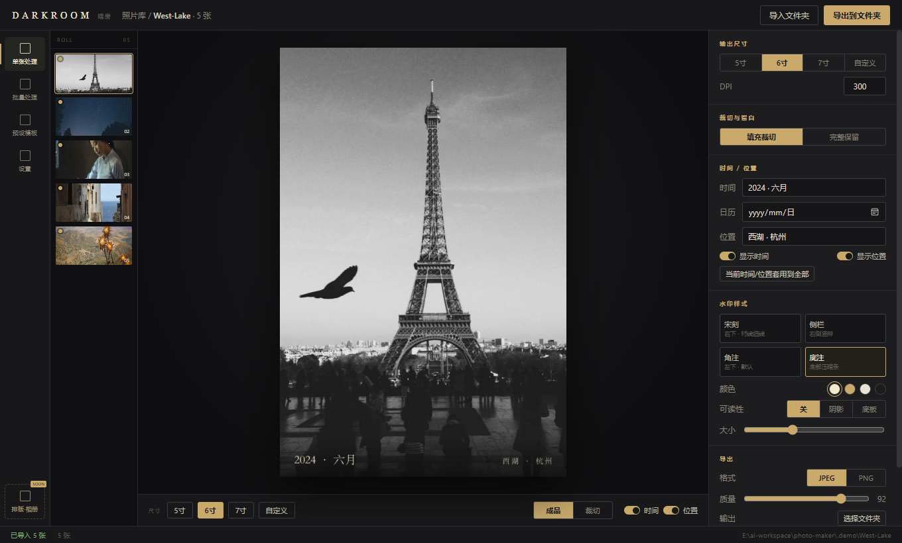
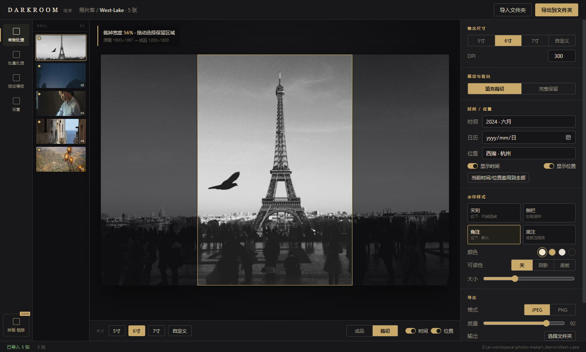
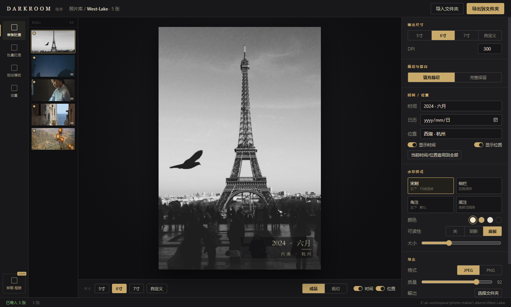

<div align="center">


# DARKROOM

**Print-ready photo preparation for Windows.**

Crop to standard print sizes, stamp the capture time and place, and export in batches — offline and fast.

<br />

<a href="https://github.com/zofun/darkroom/releases/download/v0.1.0/DARKROOM-0.1.0-windows-x64.exe">
  
</a>
<a href="https://github.com/zofun/darkroom/releases">
  
</a>

<br />

[English](README.md) · [中文说明](README.zh-CN.md)

</div>



## Overview

DARKROOM is a desktop pre-press tool for people who order physical photo prints.
It turns a folder of mixed phone and camera photos into a clean set of files that
match standard print sizes, with an elegant time-and-place caption baked in.

Everything runs locally. No account, no cloud, and no map API key.

## Download

**[Download DARKROOM for Windows (64-bit, portable)](https://github.com/zofun/darkroom/releases/download/v0.1.0/DARKROOM-0.1.0-windows-x64.exe)**

- Portable executable — no installer, just run it.
- Windows 10 / 11. The WebView2 runtime is required (preinstalled on Windows 11).
- HEIC / HEIF import requires the *HEIF Image Extensions* from the Microsoft Store.
- All releases: <https://github.com/zofun/darkroom/releases>

## Features

| | |
|---|---|
| **Standard print sizes** | 5-inch (3.5×5″), 6-inch (4×6″), 7-inch (5×7″) and custom sizes in millimeters, rendered at 300 DPI by default. |
| **Crop with full control** | Fill-crop by default, or keep the whole frame with a white border. A dedicated crop view shows the original, the retained frame, and exactly how much is lost. Drag the frame to choose the composition. |
| **Time & place captions** | Reads EXIF capture time and GPS. Reverse-geocodes coordinates to Chinese place names using a bundled offline database. Missing information can be typed in and applied to the whole batch. |
| **Four caption styles** | *Engraved*, *Side rail*, *Corner note* (default) and *Footer band*, each adjustable in color and scale. |
| **Readability modes** | Optional soft shadow or a semi-transparent backing plate with a fine outline, so captions stay legible on light, dark or busy photos. |
| **Batch export** | Export every photo to a chosen folder with progress, cancellation, collision-safe naming and atomic writes. |
| **Native performance** | A Rust image pipeline with bounded parallelism keeps memory in check on 12–48 MP photos. |

## Screenshots

**Crop view — see exactly what is lost and choose the framing.**



**Readability — a backing plate with a fine outline keeps the caption legible.**



## Quick start

1. Download and run `DARKROOM-0.1.0-windows-x64.exe`.
2. Click **导入文件夹** (Import folder) and pick a folder of photos.
3. Choose a print size and refine the crop.
4. Set the date and place, and pick a caption style.
5. Click **导出到文件夹** (Export to folder) and choose a destination.

## Build from source

### Prerequisites

- Node.js 20+
- Rust 1.90+ with the MSVC toolchain
- WebView2 runtime (Windows)

### Commands

```bash
npm install
npm run tauri dev      # development
npm run tauri build    # production build
```

### Tests

```bash
npm test                                              # frontend (Vitest)
cargo test --manifest-path src-tauri/Cargo.toml       # Rust engine
```

## Tech stack

- **Shell:** Tauri v2
- **Frontend:** React + TypeScript + Vite, Zustand
- **Image engine:** Rust (`image`, `resvg`/`usvg`, `rayon`)
- **Metadata:** `kamadak-exif`
- **HEIC:** Windows Imaging Component (system HEIF codec)
- **Place names:** bundled offline database

## Project structure

```
src/                     React UI (workspace, inspector, crop editor)
src-tauri/src/core/      Pure Rust engine (sizes, crop, EXIF, places,
                         watermarks, pipeline, export, batch)
src-tauri/src/commands.rs Tauri command bridge
src-tauri/assets/        Bundled font and offline place database
docs/screenshots/        README screenshots
```

## Roadmap

- Album and contact-sheet layout. The navigation entry is already reserved.
- Saved presets and reusable caption templates.

## Notes and limitations

- Place names are resolved offline at city level. Specific landmarks can be edited manually.
- The bundled font is a Songti copy for local builds. Replace it with an OFL-licensed
  font (for example Source Han Serif) before redistributing.
- The project does not declare a license yet.

<div align="center"><sub>© 2026 zofun</sub></div>
