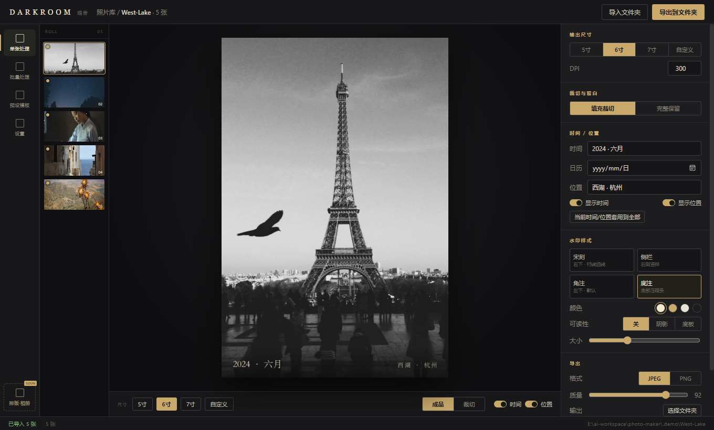
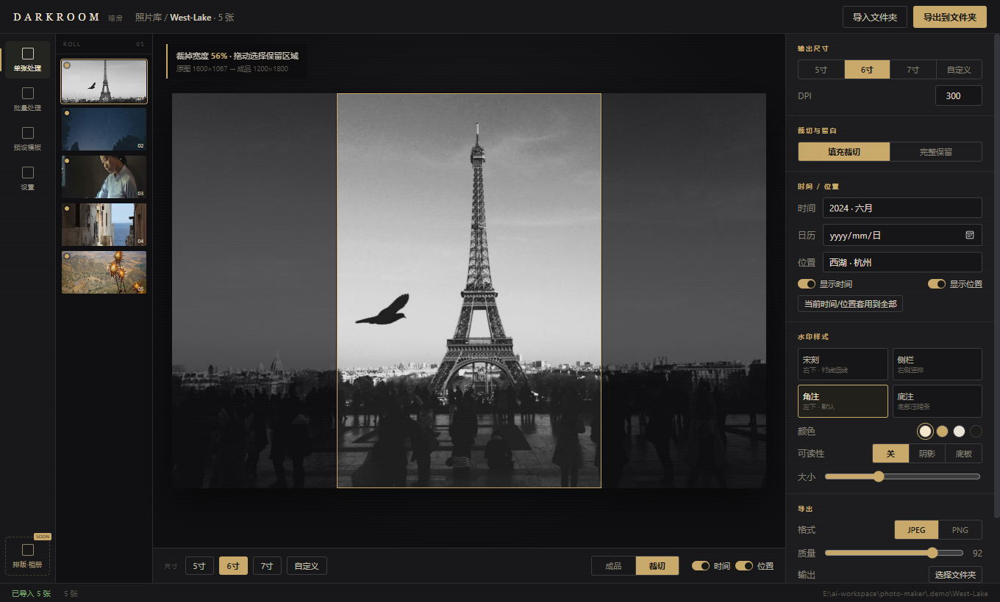
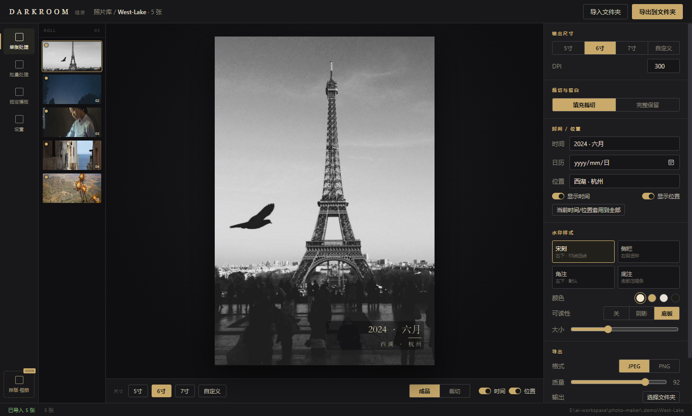

<div align="center">


# DARKROOM 暗房

**面向 Windows 的照片冲印预处理工具。**

把照片规整成标准冲印尺寸，加上美观的拍摄时间与地点，再批量导出——全程离线、快速。

<br />

<a href="https://github.com/zofun/darkroom/releases/download/v0.1.0/DARKROOM-0.1.0-windows-x64.exe">
  
</a>
<a href="https://github.com/zofun/darkroom/releases">
  
</a>

<br />

[English](README.md) · [中文说明](README.zh-CN.md)

</div>



## 简介

DARKROOM 是一款面向「冲印实体照片」场景的桌面预处理工具。它能把一个混有手机与相机照片的文件夹，
整理成符合标准冲印尺寸、并带有优雅时间地点落款的成片。

所有处理都在本地完成：不需要账号、不联网、也不需要配置任何地图 API Key。

## 下载

**[下载 DARKROOM Windows 客户端（64 位，免安装）](https://github.com/zofun/darkroom/releases/download/v0.1.0/DARKROOM-0.1.0-windows-x64.exe)**

- 单文件可执行程序，免安装，直接运行。
- 支持 Windows 10 / 11，需要 WebView2 运行时（Windows 11 已内置）。
- 导入 HEIC / HEIF 需要从微软商店安装「HEIF 图像扩展」。
- 所有版本：<https://github.com/zofun/darkroom/releases>

## 功能

| | |
|---|---|
| **标准冲印尺寸** | 5 寸（3.5×5″）、6 寸（4×6″）、7 寸（5×7″），以及自定义毫米尺寸，默认 300 DPI。 |
| **可控裁切** | 默认填充裁切，也可完整保留并加白边。独立「裁切」视图展示原图、保留框与损失比例，拖动保留框即可决定构图。 |
| **时间与地点** | 自动读取 EXIF 拍摄时间与 GPS，用内置离线地名库把坐标转成中文地名。信息缺失时可手动输入并一键套用到全部照片。 |
| **四种水印样式** | 宋刻、侧栏、角注（默认）、底注，颜色与大小均可调。 |
| **可读性增强** | 可选柔和阴影，或半透明压暗底板 + 细描边，让落款在浅色、深色或杂乱背景上都清晰。 |
| **批量导出** | 导出到指定文件夹，带进度与取消，自动处理重名，写入采用原子替换。 |
| **原生性能** | Rust 图像管线，按内存预算限制并行度，几十张 12–48MP 照片也能快速完成。 |

## 截图

**裁切视图——清楚看到损失，自己决定保留哪里。**



**可读性——压暗底板加细描边，落款始终清晰。**



## 快速上手

1. 下载并运行 `DARKROOM-0.1.0-windows-x64.exe`。
2. 点击「导入文件夹」，选择照片目录。
3. 选择冲印尺寸，按需调整裁切。
4. 填写或确认日期、地点，选择落款样式。
5. 点击「导出到文件夹」，选择输出目录。

## 从源码构建

### 环境要求

- Node.js 20+
- Rust 1.90+（MSVC 工具链）
- WebView2 运行时（Windows）

### 命令

```bash
npm install
npm run tauri dev      # 开发调试
npm run tauri build    # 生产构建
```

### 测试

```bash
npm test                                              # 前端（Vitest）
cargo test --manifest-path src-tauri/Cargo.toml       # Rust 引擎
```

## 技术栈

- **外壳：** Tauri v2
- **前端：** React + TypeScript + Vite，Zustand
- **图像引擎：** Rust（`image`、`resvg`/`usvg`、`rayon`）
- **元数据：** `kamadak-exif`
- **HEIC：** Windows Imaging Component（系统 HEIF 编解码器）
- **地名：** 内置离线地名库

## 项目结构

```
src/                     React 界面（工作台、属性面板、裁切编辑器）
src-tauri/src/core/      纯 Rust 引擎（尺寸、裁切、EXIF、地名、
                         水印、管线、导出、批处理）
src-tauri/src/commands.rs Tauri 命令桥接
src-tauri/assets/        内置字体与离线地名库
docs/screenshots/        README 截图
```

## 路线图

- 相册排版 / 联系表（左侧导航入口已预留）。
- 可保存的预设与落款模板。

## 说明与限制

- 地名由离线库解析到城市级，具体景点可手动补充。
- 内置字体为本地构建用的宋体副本；正式分发前建议替换为 OFL 许可字体（如思源宋体）。
- 本项目暂未声明开源许可证。

<div align="center"><sub>© 2026 zofun</sub></div>
